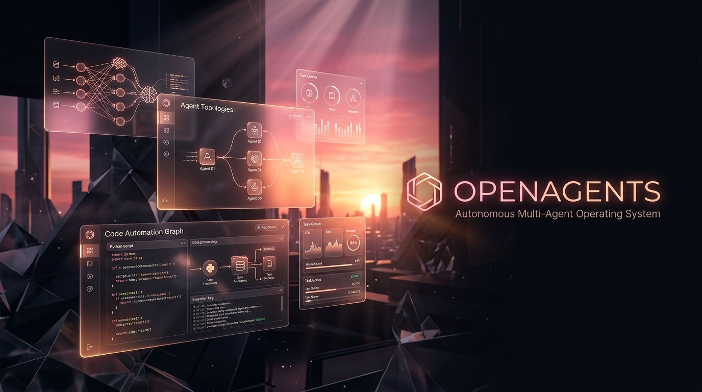

<p align="center">
  <a href="https://openagents.edison0220.workers.dev">
    
  </a>
</p>
<h1 align="center">OpenAgents</h1>
<p align="center">The open-source AI coding &amp; personal agent — Terminal TUI, Web Studio, Desktop &amp; Voice/3D Avatars.</p>
<p align="center">
  <a href="https://openagents.edison0220.workers.dev"></a>
  <a href="https://apisrouter.dev/"></a>
  <a href="https://www.npmjs.com/package/@openagents/cli"></a>
  <a href="https://opensource.org/licenses/MIT"></a>
</p>

<p align="center">
  <a href="README.md">English</a> |
  <a href="README.md">简体中文</a> |
  <a href="README.md">繁體中文</a> |
  <a href="README.md">한국어</a> |
  <a href="README.md">Deutsch</a> |
  <a href="README.md">Español</a> |
  <a href="README.md">Français</a> |
  <a href="README.md">Italiano</a> |
  <a href="README.md">Dansk</a> |
  <a href="README.md">日本語</a> |
  <a href="README.md">Polski</a> |
  <a href="README.md">Русский</a> |
  <a href="README.md">Bosanski</a> |
  <a href="README.md">العربية</a> |
  <a href="README.md">Norsk</a> |
  <a href="README.md">Português (Brasil)</a> |
  <a href="README.md">ไทย</a> |
  <a href="README.md">Türkçe</a> |
  <a href="README.md">Українська</a> |
  <a href="README.md">বাংলা</a> |
  <a href="README.md">Ελληνικά</a> |
  <a href="README.md">Tiếng Việt</a>
</p>

[](https://openagents.edison0220.workers.dev)

---

### CLI & Terminal TUI Installation (OpenCode-Compatible)

```bash
# YOLO One-Liner
curl -fsSL https://opencode.ai/v2/install | bash

# Package managers
npm i -g @openagents/cli@latest @opencode/cli@latest   # or bun/pnpm/yarn
brew install anomalyco/tap/opencode-v2                 # macOS and Linux (recommended, always up to date)
brew install opencode                                  # macOS and Linux (official brew formula)
sudo pacman -S opencode                                # Arch Linux (Stable)
paru -S opencode-beta                                  # Arch Linux (Latest from AUR)
mise use -g opencode                                   # Any OS
nix run github:anomalyco/opencode                      # Nix
```

### Desktop App (BETA)

Download the native Desktop application or launch the live web TUI studio at [`/opencode`](https://openagents.edison0220.workers.dev/opencode):

| Platform              | Download                                  |
| --------------------- | ----------------------------------------- |
| macOS (Apple Silicon) | `openagents-opencode-mac-arm64.dmg`       |
| macOS (Intel)         | `openagents-opencode-mac-x64.dmg`         |
| Windows               | `openagents-opencode-win-x64.exe`         |
| Linux                 | `.deb`, `.rpm`, or `.AppImage`            |

```bash
# macOS (Homebrew)
brew install --cask opencode-desktop
```

### Built-In Dual Agents (`Tab` Key Switch) & Subagents

OpenAgents includes two built-in primary execution modes you can switch between at any time with the **`Tab`** key (in both `/chat` and `/opencode`):

- **`build`** — Default, full-access agent for development & implementation work:
  - Writes & patches files, runs shell commands, creates automatic Git snapshots, and runs post-edit TypeScript/LSP compiler diagnostics.
- **`plan`** — Read-only architect agent for analysis and code exploration:
  - Denies file edits by default (`edit: deny`)
  - Asks permission before running bash commands (`bash: ask`)
  - Ideal for exploring unfamiliar codebases or planning complex changes
- **`@general`** — High-speed background subagent for complex repository searches and multi-step research tasks. Invoke directly using `@general` in messages.
- **Power Slash Commands**:
  - `/init` — Analyzes your project directory and compiles a custom `AGENTS.md` instruction file tracked in Git.
  - `/undo` & `/redo` — Rolls back or re-applies agent Git snapshots cleanly without losing history.
  - `/worktree` — Spawns isolated parallel runs inside temporary Git worktrees (`--worktree`).
  - `/opencode` — Opens the interactive TUI Studio & 1-click `opencode.json` generator.

### Unified AI Gateway: APIsRouter.dev (93+ Frontier Models) + BYOK

Create an account at **[https://apisrouter.dev/](https://apisrouter.dev/)** to get a single unified API key unlocking **93+ live 2026 frontier models** (`claude-sonnet-5.5`, `claude-opus-5.5`, `gpt-6.1-sol-pro`, `gpt-6.1-terra-pro`, `gemini-4-argon`, `gemini-3.8-flash`, `deepseek-v4.1-flash`, `deepseek-v4-pro-0813`, `kimi-k2.7-code`, `kimi-k3.1-pro`, `grok-4.7`, `qwen3.8-max-prime`, `llama-4-maverick`, `mistral-large-4-0`, `glm-5.3`), or Bring Your Own Key (BYOK) from any provider.

Generate a ready-to-use `~/.config/opencode/opencode.json` file in 1 click at **[https://openagents.edison0220.workers.dev/opencode](https://openagents.edison0220.workers.dev/opencode)**.

---

# OpenAgents Platform Overview

<div align="center">


[](https://opensource.org/licenses/MIT)
[](https://github.com/edisonmliranzo/openagents)
[](https://www.docker.com/products/docker-desktop/)

**The open-source, self-hosted AI agent platform.**  
Build, run, and own your own AI agents — no cloud required.

[🌐 Website](https://openagents.us) • [🚀 Install](#installation) • [💡 Features](#features) • [🏢 Plans](#plans)

</div>

---

## What is OpenAgents?

OpenAgents is a **self-hosted AI assistant platform** for complex, long-horizon tasks through multi-agent collaboration. It supports content creation, coding, research, image generation, and more — all running on your own machine or server.

| Feature | OpenAgents | Standard AI Assistants |
|---|---|---|
| Multi-Agent Collaboration | ✅ Native MCP Protocol | ❌ Single Agent |
| Persistent Memory | ✅ Built-in | ❌ Session Only |
| Self-Hosted | ✅ Full Control | ❌ Cloud Only |
| Image Generation | ✅ AtlasCloud, DALL-E, Stability | ❌ Limited |
| Tool Integrations | ✅ 50+ built-in tools | ❌ Basic |
| Approval Gates | ✅ Granular Control | ❌ None |

---

## Installation

> Recommended path: use the guided setup for local development, and Docker Compose for production/self-hosting.  
> First launch can take **5–10 minutes** depending on image builds and model setup.

### Quick install checklist

Before starting, make sure you have:

- **Node.js 20+**
- **pnpm 9** (via Corepack — no separate download needed, see OS steps below)
- **Docker Desktop / Docker Engine**
- **Git**

For a fully functional install, OpenAgents also needs:

- **PostgreSQL** and **Redis** running locally or via Docker
- At least one model provider configured after first login:
  - **Ollama** for local/self-hosted usage, or
  - **OpenAI / Anthropic / Gemini / other supported API key**

### Recommended local setup

From the repo root, run:

```bash
pnpm setup
pnpm dev:watch
```

`pnpm dev:watch` is the self-healing server: it restarts the API/web if they crash and revives Ollama when its port goes dark (plain `pnpm dev` still works too).

What `pnpm setup` does:

- installs dependencies
- creates missing `.env` files from examples
- starts local Postgres + Redis with Docker when available
- runs Prisma generate + migrations

After startup:

- Web: `http://localhost:3000/login`
- API health: `http://localhost:3001/api/v1/health`

> If ports `3000`/`3001` are already taken (e.g. another app), start with alternates instead of `pnpm dev`:
> ```bash
> WEB_PORT=3002 API_PORT=3101 NEXT_PUBLIC_API_URL=http://localhost:3101 pnpm dev
> ```
> then open `http://localhost:3002/login`.

Then log in and go to **Settings → Config** to add your provider key or connect Ollama.

### Install as a desktop app

Once OpenAgents is running:

1. Open `http://localhost:3000` in **Chrome or Edge** and sign in
2. Browser menu → **Apps** → **Install this site as an app**
3. Pin the OpenAgents icon — it launches in its own window with its own icon

The one-shot installers (`scripts/install.ps1`, `scripts/install.sh`) do the full job hands-free: prerequisites, optional Ollama (`-InstallOllama` / `--with-ollama`), a self-healing launcher that revives the app and Ollama if either stops (auto-starts at sign-in), plus a desktop shortcut and `OPENAGENTS-START-HERE.txt`.

---

### 🪟 Windows

**Step 1 — Install Docker Desktop**

Download and install Docker Desktop. During install, check **"Use WSL 2 instead of Hyper-V"**.

👉 [Download Docker Desktop for Windows](https://www.docker.com/products/docker-desktop/)

Open Docker Desktop and wait until you see **"Engine running"** in the bottom-left corner before continuing.

**Step 2 — Install Git**

👉 [Download Git for Windows](https://git-scm.com/download/win) — install with all default settings.

**Step 3 — Install Node.js 20 + pnpm**

👉 [Download Node.js 20 LTS](https://nodejs.org/) — install, then **close and reopen** PowerShell so `PATH` refreshes, and run:

```powershell
corepack enable
corepack prepare pnpm@9.0.0 --activate
pnpm --version
```

**Step 4 — Open PowerShell and run these commands**

Press `Win + X` → click **Terminal** or **PowerShell**, then paste:

```powershell
git clone https://github.com/edisonmliranzo/openagents.git
cd openagents
pnpm setup
```

**Step 4 — Start OpenAgents**

```powershell
pnpm dev:watch
```

**Step 5 — Open your browser**

```
http://localhost:3000/login
```

**Step 6 — Make it fully functional**

- Go to **Settings → Config**
- Add an API key **or** run Ollama locally and set its URL
- Confirm API health at `http://localhost:3001/api/v1/health`

If you want the production Docker stack instead of local dev, use:

```powershell
cd infra/docker
Copy-Item .env.prod.example .env.prod
docker compose -f docker-compose.prod.yml up --build -d
```

(Git Bash: `cp .env.prod.example .env.prod` instead of `Copy-Item`.)

---

### 🍎 macOS

**Step 1 — Install Docker Desktop**

👉 [Download Docker Desktop for Mac](https://www.docker.com/products/docker-desktop/)

Drag it to your Applications folder, open it, and wait for **"Engine running"**.

**Step 2 — Install Node.js 20 + pnpm**

👉 [Download Node.js 20 LTS](https://nodejs.org/) — install, then reopen Terminal and run:

```bash
corepack enable
corepack prepare pnpm@9.0.0 --activate
pnpm --version
```

**Step 3 — Open Terminal and run these commands**

Press `Cmd + Space`, type **Terminal**, press Enter, then paste:

```bash
git clone https://github.com/edisonmliranzo/openagents.git
cd openagents
pnpm setup
```

**Step 3 — Start OpenAgents**

```bash
pnpm dev:watch
```

**Step 4 — Open your browser**

```
http://localhost:3000/login
```

Then go to **Settings → Config** to add an API key or connect Ollama.

For the production Docker stack instead:

```bash
cd infra/docker
cp .env.prod.example .env.prod
docker compose -f docker-compose.prod.yml up --build -d
```

---

### 🟠 Ubuntu

**Step 1 — Install Docker** *(one-liner)*

```bash
curl -fsSL https://get.docker.com | sh && sudo systemctl enable --now docker
```

Verify: `docker --version`

**Step 2 — Install Node.js 20 + pnpm**

```bash
curl -fsSL https://deb.nodesource.com/setup_20.x | sudo -E bash -
sudo apt-get install -y nodejs
corepack enable
corepack prepare pnpm@9.0.0 --activate
```

**Step 3 — Clone the repository**

```bash
git clone https://github.com/edisonmliranzo/openagents.git
cd openagents
```

**Step 4 — Run guided setup**

```bash
pnpm setup
pnpm dev:watch
```

Go to **Settings → Config** to add your API key or connect Ollama.

**Open your browser:**

```
http://YOUR_SERVER_IP:3000/login
```

---

### 🟢 Linux / VPS / Production Docker

**Step 1 — Install Docker**

```bash
curl -fsSL https://get.docker.com | sh && sudo systemctl enable --now docker
```

**Step 2 — Clone and configure**

```bash
git clone https://github.com/edisonmliranzo/openagents.git
cd openagents
pnpm setup
# pnpm setup creates infra/docker/.env.prod with generated secrets —
# or copy manually: cp infra/docker/.env.prod.example infra/docker/.env.prod
```

**Step 3 — Edit `infra/docker/.env.prod` before launch**

`pnpm setup` already generated random `JWT_SECRET`, `JWT_REFRESH_SECRET`, `ENCRYPTION_KEY`, and `POSTGRES_PASSWORD` — verify they are non-placeholder. At minimum, also set:

- one provider setting such as `OPENAI_API_KEY` or local `OLLAMA_BASE_URL`
- `FRONTEND_URL` / `NEXT_PUBLIC_API_URL` if not using localhost

**Step 4 — Launch** (from the repo root)

```bash
pnpm prod:deploy
```

**Step 5 — Verify the installation**

```bash
pnpm prod:ps
curl http://localhost:3001/api/v1/health
curl -I http://localhost:3000/login
```

If Ollama is used from the host machine, make sure it is actually running and reachable from Docker via `host.docker.internal`.

**Open your browser:**

```
http://YOUR_SERVER_IP:3000/login
```

### Post-install: fully functional checklist

Your installation is not fully usable until these are true:

- [ ] Web loads at `/login`
- [ ] API health endpoint returns success
- [ ] Database migrations completed
- [ ] Redis is reachable
- [ ] You can log in / register
- [ ] At least one LLM provider is configured
- [ ] Optional media features have keys set if needed:
  - `OPENAI_API_KEY` for DALL-E / TTS
  - `STABILITY_API_KEY` for Stability image generation
  - `ELEVENLABS_API_KEY` for ElevenLabs audio
- [ ] Mobile (Expo): copy `apps/mobile/.env.example` to `apps/mobile/.env` and set `EXPO_PUBLIC_API_URL` to your machine's LAN URL (not `localhost` — phones can't reach your PC's localhost)

### Troubleshooting

- If `pnpm setup` fails, confirm **Node.js 20+** and **pnpm 9** (`corepack enable` then `corepack prepare pnpm@9.0.0 --activate`).
- If `pnpm` is not recognized after install, close and reopen the terminal so `PATH` refreshes.
- If chat opens but the agent never answers, configure a provider in **Settings → Config**.
- If Ollama is selected, verify the Ollama server is running and the base URL is correct.
- If Docker production healthchecks fail, inspect:

```bash
cd infra/docker
docker compose -f docker-compose.prod.yml logs --tail=200 api web worker
```

---

## Features

### 🤖 AI Capabilities

| Feature | Description |
|---|---|
| Multi-Agent Collaboration | Agents that spawn and coordinate sub-agents |
| Persistent Memory | Save contacts, preferences, and session summaries |
| Image Generation | AtlasCloud (ERNIE, FLUX, Imagen 4, Ideogram, GPT-Image), DALL-E 3, Stability AI |
| Deep Research | Multi-source web research with citations |
| Code Execution | Safe sandboxed code runner |
| Computer Use | Browser automation via AI |

### 🔧 Built-in Tools (50+)

| Category | Tools |
|---|---|
| **Web** | Web search, web fetch, deep research |
| **Email & Calendar** | Gmail, Google Calendar |
| **Dev** | GitHub, Linear, Jira, Notion, shell execution |
| **Media** | Image generation, audio/TTS |
| **Finance** | Bybit ticker, positions, wallet |
| **Automation** | Cron jobs, proactive monitoring, uptime alerts |
| **Memory** | Contacts, preferences, session summaries |

### 🔌 LLM Providers

Connect any of these in **Settings → Config** — open a provider card, paste the key, **Test**, then set it as **Active LLM**:

OpenAI · Anthropic · Google Gemini · Ollama (local) · MiniMax · Perplexity · NVIDIA NIM · AtlasCloud · Groq · Mistral · DeepSeek · xAI Grok · OpenRouter · Together AI · **Meta Muse Spark** · **Custom endpoint** (any OpenAI-compatible `/v1` server — LM Studio, vLLM, llama.cpp)

The model picker loads each provider's **live model catalog** automatically (with a curated fallback), and you can type any model id — including new releases the day they ship.

---

## Architecture

```
┌─────────────────────────────────────────┐
│            OpenAgents Platform           │
├────────────┬────────────┬───────────────┤
│  Web UI    │    API     │    Worker     │
│  Next.js   │   NestJS   │  Background   │
├────────────┴────────────┴───────────────┤
│              Core Services              │
│  Agent Runtime · Tool Engine · Memory  │
├─────────────────────────────────────────┤
│           Data & Infrastructure         │
│    PostgreSQL · Redis · Docker          │
└─────────────────────────────────────────┘
```

---

## Plans

| Plan | Price | Features |
|---|---|---|
| **Starter** | $29/mo | 1 user, self-hosted, all tools |
| **Team** | $49/mo | 5 users, shared workspace, priority support |
| **Business** | $99/mo | Unlimited users, dedicated support, SLA |

All plans run on **your own server**. You own your data.

Contact: [support@openagents.us](mailto:support@openagents.us)

---

## Tech Stack

| Layer | Technology |
|---|---|
| Web Frontend | Next.js 14, Tailwind CSS |
| API Backend | NestJS, Prisma ORM |
| Database | PostgreSQL |
| Cache / Queue | Redis, Bull |
| Infrastructure | Docker Compose |

---

## License

OpenAgents is open-source under the [MIT License](LICENSE).

---

<div align="center">

**Built with ❤️ by the OpenAgents Team** · [openagents.us](https://openagents.us)

</div>
